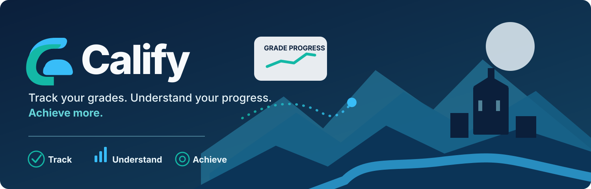
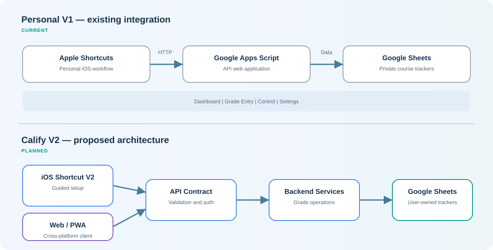

<div align="center">


# Calify

### Academic grade tracking powered by iOS automation and Google Workspace

**Record academic assessments, automate grade entry, and visualize course progress.**

[](docs/ROADMAP.md)
[](#-tech-stack)
[](#-getting-started)
[](LICENSE)

[**Architecture**](docs/ARCHITECTURE.md) · [**Roadmap**](docs/ROADMAP.md) · [**iOS V2 Design**](docs/design/IOS_SHORTCUT_V2.md) · [**Security**](docs/PRIVACY_AND_SECURITY.md) · [**License**](LICENSE) · [**Releases**](https://github.com/yeremyacuna/calify/releases)

</div>

---

<div align="center">
  
</div>

## 📑 Table of Contents

- [Overview](#-overview)
- [Brand Identity](#-brand-identity)
- [V1 Core Capabilities](#-calify-v1--core-capabilities)
- [Architecture](#️-architecture)
- [Tech Stack](#️-tech-stack)
- [Project Structure](#-project-structure)
- [Getting Started](#-getting-started)
- [Roadmap](#️-engineering-roadmap)
- [Documentation](#-documentation)
- [Security & Privacy](#-security--privacy)
- [License](#-license)

---

## 📖 Overview

**Calify** is an independent software engineering project that connects **Apple Shortcuts**, a **Google Apps Script API**, and **Google Sheets** to simplify academic assessment tracking.

Calify V1 is currently used as a functional personal iOS-to-Google-Workspace workflow. This repository documents the existing architecture while preparing a secure, reusable public distribution. Future features are documented separately in the [engineering roadmap](docs/ROADMAP.md).

> [!IMPORTANT]
> **Project status:** this public repository currently contains documentation and a future-facing project scaffold—not an installable release. The functioning personal Shortcut, its credentials, personal trackers, and unreviewed production code are **not published** here.

## 🎨 Brand Identity

<div align="center">
  
  <p><strong>Cool Academic</strong> · Midnight Navy · Teal · Cyan</p>
</div>

Calify uses the selected **Option 01 — Cool Academic** visual direction: a composed educational identity combining trust, clarity and measurable progress. Its design system specifies **Plus Jakarta Sans** for headings and **Inter** for body text, with a consistent 8 px spacing rhythm.

<div align="center">
<table align="center">
<thead><tr><th align="center">Midnight Navy</th><th align="center">Teal</th><th align="center">Cyan</th><th align="center">Soft White</th><th align="center">Slate</th></tr></thead>
<tbody><tr><td align="center"><code>#0B1F3B</code></td><td align="center"><code>#14B8A6</code></td><td align="center"><code>#38BDF8</code></td><td align="center"><code>#F8FAFC</code></td><td align="center"><code>#64748B</code></td></tr></tbody>
</table>
</div>

[**Brand Guidelines**](assets/branding/README.md) · [**App Icon**](assets/branding/calify-app-icon.svg) · [**Logo Variations**](assets/branding/calify-logo-monochrome.svg) · [**Design Tokens**](assets/branding/design-tokens.json)

> **Design status:** Vector artwork in this repository is an editable interpretation of the approved branding concept. Product UI previews are conceptual; no web/mobile app UI has been released.

## ✨ Calify V1 — Core Capabilities

<div align="center">
<table align="center">
<thead><tr><th align="center">Component</th><th align="center">Existing Functionality</th></tr></thead>
<tbody>
<tr><td align="center"><strong>Mobile Client</strong></td><td align="center">Apple Shortcuts workflow for personal grade recording</td></tr>
<tr><td align="center"><strong>Web API</strong></td><td align="center">Google Apps Script endpoint handling JSON requests</td></tr>
<tr><td align="center"><strong>Academic Data</strong></td><td align="center">Google Sheets trackers with course-specific grading rules</td></tr>
<tr><td align="center"><strong>Grade Entry</strong></td><td align="center">Score recording and completion-based assessments</td></tr>
<tr><td align="center"><strong>Analytics</strong></td><td align="center">Calculated academic results and Dashboard summaries</td></tr>
</tbody>
</table>
</div>


The current personal workflow exists; its source code and original Shortcut are not public distribution artifacts.

## 🏗️ Architecture

<div align="center">
  
</div>

**Diagram type:** High-level System Architecture / Component Diagram (top-down). **Mobile** refers to the Apple Shortcuts iOS client; **Web API** refers to the server-side Google Apps Script Web App—not a separate browser frontend.

Each tracker uses four worksheets: **Dashboard → Grade Entry → Control → Settings**. Course-specific formulas distinguish pending scores from legitimate zero scores and actual results from projections.

📄 [Explore the detailed architecture and Mermaid diagrams](docs/ARCHITECTURE.md)

## 🛠️ Tech Stack

<div align="center">
<table align="center">
<thead><tr><th align="center"><strong>Current Integration</strong></th><th align="center"><strong>Development Tooling</strong></th></tr></thead>
<tbody>
<tr><td align="center"></td><td align="center"></td></tr>
<tr><td align="center"></td><td align="center"></td></tr>
<tr><td align="center"></td><td align="center"></td></tr>
<tr><td align="center"></td><td align="center"></td></tr>
<tr><td align="center"></td><td align="center"></td></tr>
</tbody>
</table>
</div>

GitHub Actions and `clasp` remain tooling planned for recovery and CI/CD. Badges do not imply that those pipelines are deployed.

## 📂 Project Structure

```text
calify/
├── .github/
│   ├── workflows/              # Future CI/CD pipelines
│   └── ISSUE_TEMPLATE/         # Issue templates
├── apps/
│   ├── ios-shortcuts/
│   │   ├── templates/          # Sanitized Shortcut sources (future)
│   │   └── releases/           # Verified distributable Shortcuts (future)
│   └── web/
│       ├── public/             # Web static assets (future)
│       └── src/                # Web/PWA source code (future)
├── backend/
│   └── apps-script/
│       ├── src/                # Reviewed public .gs modules (future)
│       └── tests/              # Backend tests (future)
├── packages/
│   ├── api-contracts/          # Shared API contract (future)
│   └── grading-engine/        # Evaluated shared calculation logic
├── config/
│   └── examples/              # Safe configuration examples (future)
├── assets/
│   ├── branding/              # Selected logo, app icon, banner and tokens
│   ├── diagrams/              # Public architecture diagrams
│   └── screenshots/           # Verified demo screenshots (future)
├── docs/
│   ├── api/
│   ├── design/
│   ├── decisions/
│   ├── guides/
│   ├── sheets/
│   ├── ARCHITECTURE.md
│   ├── ROADMAP.md
│   ├── PRIVACY_AND_SECURITY.md
│   ├── BRANCHING_STRATEGY.md
│   └── LICENSING.md
├── infra/
│   └── apps-script/           # Deployment configuration (future)
├── scripts/                   # Maintenance tooling (future)
├── tests/                     # Integration tests (future)
├── .gitignore
└── README.md
```

**Scaffold rule:** folders containing `.gitkeep` are intentionally reserved. They are not evidence that a feature has already been built.

## 🚀 Getting Started

A public installation is **not yet available**. Once the audited release is ready, each student will configure their own Google account, tracker, Apps Script deployment, and iOS client. No student will need access to the maintainer's private spreadsheets or production token.

You can inspect the current documentation locally:

```bash
git clone https://github.com/yeremyacuna/calify.git
cd calify
```

No functional installation command is provided until the public setup flow has been tested with synthetic data.

## 🗺️ Engineering Roadmap

Future development and version-specific designs are maintained outside the V1 overview to avoid presenting unfinished capabilities as shipped.

📄 [Explore the complete versioned roadmap and acceptance criteria](docs/ROADMAP.md) · [Branching Strategy](docs/BRANCHING_STRATEGY.md)

## 🔐 Security & Privacy

Calify follows a privacy-first approach. The public repository must never include live credentials, personal API endpoints, private spreadsheet IDs, the signed original personal Shortcut, or real student grades. Public releases require security review and independent validation.

📄 [Security policy and safe reporting](docs/PRIVACY_AND_SECURITY.md)

## 📚 Documentation

<div align="center">
<table align="center">
<thead><tr><th align="center">Document</th><th align="center">Purpose</th></tr></thead>
<tbody>
<tr><td align="center"><a href="assets/branding/README.md">Brand Guidelines</a></td><td align="center">Visual identity, palette, typography and source assets</td></tr>
<tr><td align="center"><a href="docs/ARCHITECTURE.md">Architecture</a></td><td align="center">V1 baseline, V2 target, diagrams, data rules</td></tr>
<tr><td align="center"><a href="docs/ROADMAP.md">Roadmap</a></td><td align="center">Milestones, release gates and required learning</td></tr>
<tr><td align="center"><a href="docs/design/IOS_SHORTCUT_V2.md">iOS Shortcut V2 Design</a></td><td align="center">Proposed UX and server integration</td></tr>
<tr><td align="center"><a href="docs/PRIVACY_AND_SECURITY.md">Privacy &amp; Security Guidelines</a></td><td align="center">Privacy, source publication and responsible reports</td></tr>
<tr><td align="center"><a href="docs/BRANCHING_STRATEGY.md">Branching Strategy</a></td><td align="center">Main branch, V2 branch, feature branches and releases</td></tr>
<tr><td align="center"><a href="docs/LICENSING.md">GPLv3 Licensing Guide</a></td><td align="center">Copyleft, source distribution, attribution, and warranty terms</td></tr>
</tbody>
</table>
</div>


**Internal-only material:** detailed private audits, personal Shortcut inventories, original production exports, and personal Learning Notes are maintained outside the public repository. They are not end-user documentation.

## 🤝 Contributions

Code contributions will open after a reviewed public source baseline and contribution rules are available. Until then, use [GitHub Issues](https://github.com/yeremyacuna/calify/issues) for feature suggestions without posting secrets or academic records.

## 📄 License

**Calify is licensed under the [GNU General Public License v3.0 (GPL-3.0-only)](LICENSE).** Publicly released covered works may be used, modified, and redistributed under GPLv3 terms, including the obligation to provide corresponding source for distributed derivative versions. There is **no warranty**, subject to applicable law. GPLv3 permits forks and commercial redistribution; it does **not** prohibit cloning. The working personal Shortcut, unpublished production backend, user data, and credentials are **not included in this release**. See the [Licensing Guide](docs/LICENSING.md) for scope and compliance.

---

<div align="center">

**Calify — Learn more. Track better.**

Copyright © 2026 Yeremy Acuña ([@yeremyacuna](https://github.com/yeremyacuna)) · Licensed under [GNU GPLv3](LICENSE)

</div>
