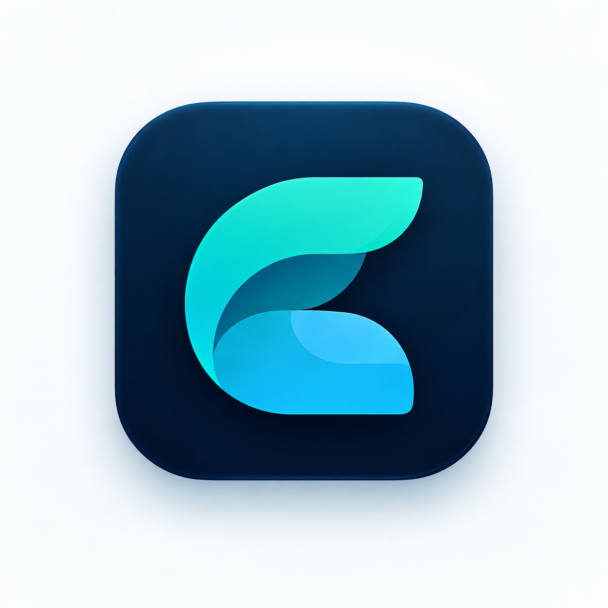
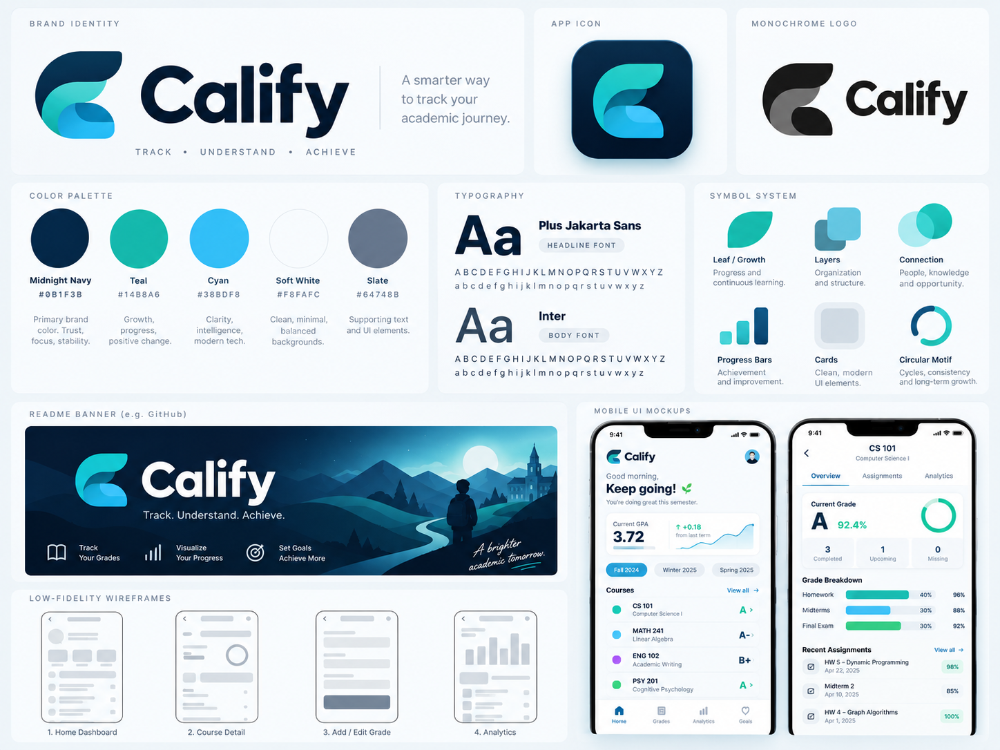
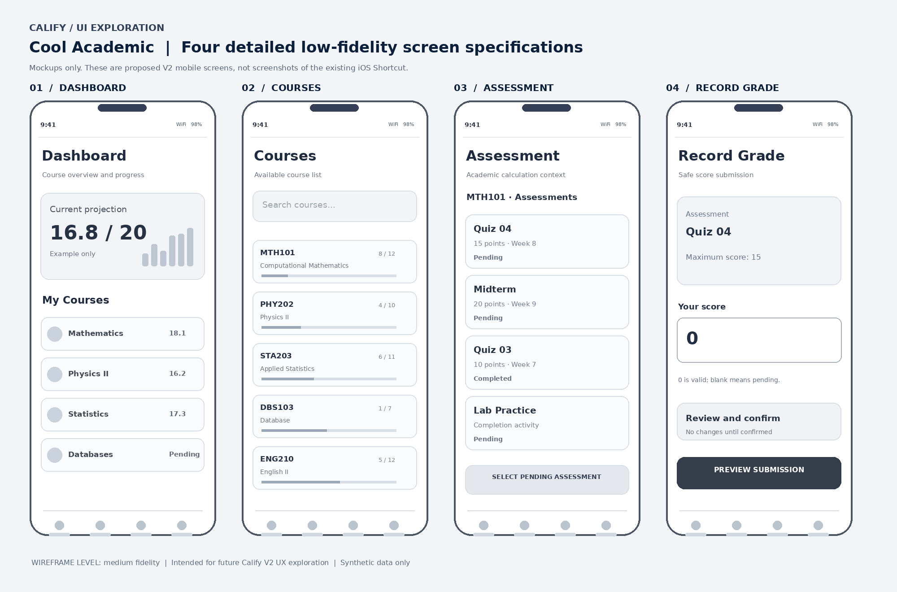

# Calify Official Visual Identity — Cool Academic

**Official visual reference:** User-selected `Option_01_Cool_Academic.zip`.

## Core identity

- **Brand mark:** original layered C in navy, teal and cyan, as shown in the original branding board.
- **Typography:** Plus Jakarta Sans (display); Inter (body).
- **Primary colors:** Midnight Navy `#0B1F3B`, Teal `#14B8A6`, Cyan `#38BDF8`.
- **Supporting colors:** Soft White `#F8FAFC`, Slate `#64748B`.

## Asset ownership and source

The PNG and PDF files within `official/` and `reference/` must be copied from the user-supplied ZIP **without recoloring or redrawing**. The `official/wordmark-crop.png` is a pixel crop of the top-left wordmark from the original branding board, preserving its original visible shapes. It is not a transparent, production-ready vector export.

| Path | Purpose |
|:---:|:---:|
| `official/app-icon.png` | Original app icon concept, including its presentation background |
| `official/readme-banner.png` | Original illustrated banner for the README |
| `official/wordmark-crop.png` | Exact pixel crop of the approved original logo artwork |
| `reference/branding-board.png` | Full selected design-system presentation |
| `reference/wireframes-detailed.png` | Conceptual high-level product wireframes |
| `reference/brand-guidelines.pdf` | Original four-page brand / HCI guidance |
| `design-tokens.json` | Formalized selected palette, fonts, and spacing |
| `ORIGINAL_ASSET_MANIFEST.json` | Integrity hashes and asset origin |

**Publication status:** All six approved PNG/PDF assets are published in GitHub at the paths above. Their Git blob SHAs match the verified original files recorded in the [asset manifest](ORIGINAL_ASSET_MANIFEST.json). The [root README](../../README.md) now renders the original logo, illustrated banner, app icon, and reference gallery.

## Official Gallery

  
  

  

<table align="center">
<thead><tr><th align="center">Brand Board</th><th align="center">Wireframe Concepts</th></tr></thead>
<tbody><tr><td align="center"></td><td align="center"></td></tr></tbody>
</table>

[**Brand Guidelines PDF**](reference/brand-guidelines.pdf) · [**Design Tokens**](design-tokens.json) · [**SHA-256 Manifest**](ORIGINAL_ASSET_MANIFEST.json)

## Product honesty

Reference mockups and wireframes are future-facing **concepts**, not screenshots of the working Calify V1. No original Shortcut, token, spreadsheet ID or production endpoint is included in these assets.

## Follow-up tasks

- [x] Publish the exact original PNG/PDF assets and display the approved images in the README.
- Produce a production-grade transparent and vector-native logo based **strictly on the approved source**; request approval before replacing the original raster.
- Check logo readability at 32px and app-icon shape at touch-target sizes.
- Verify contrast and typography in future interfaces.
- Treat PDF and concept boards as design references, not functionality evidence.
