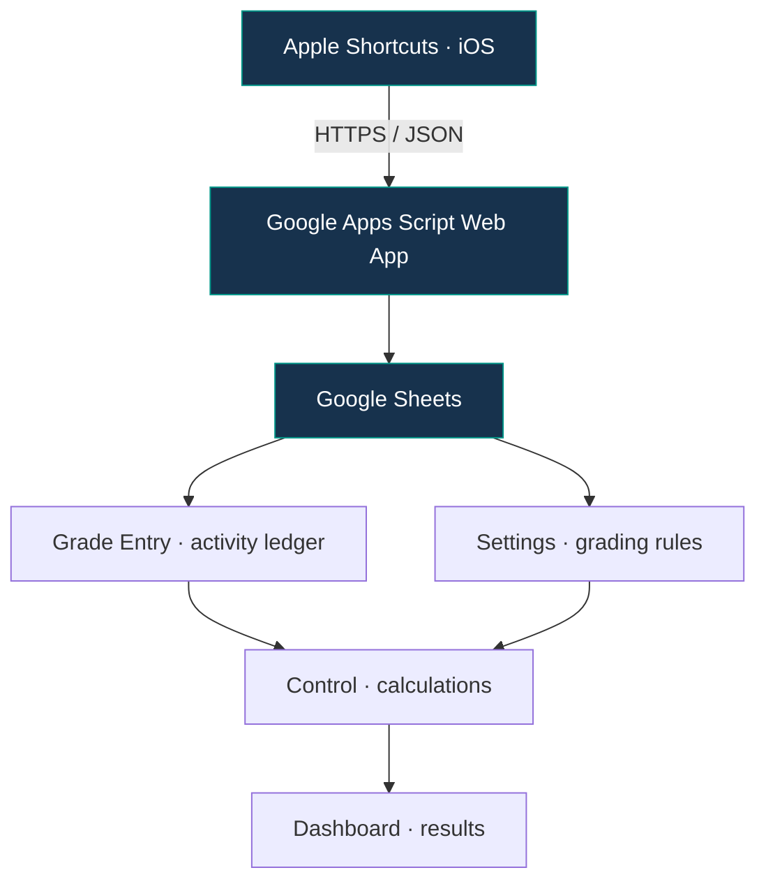
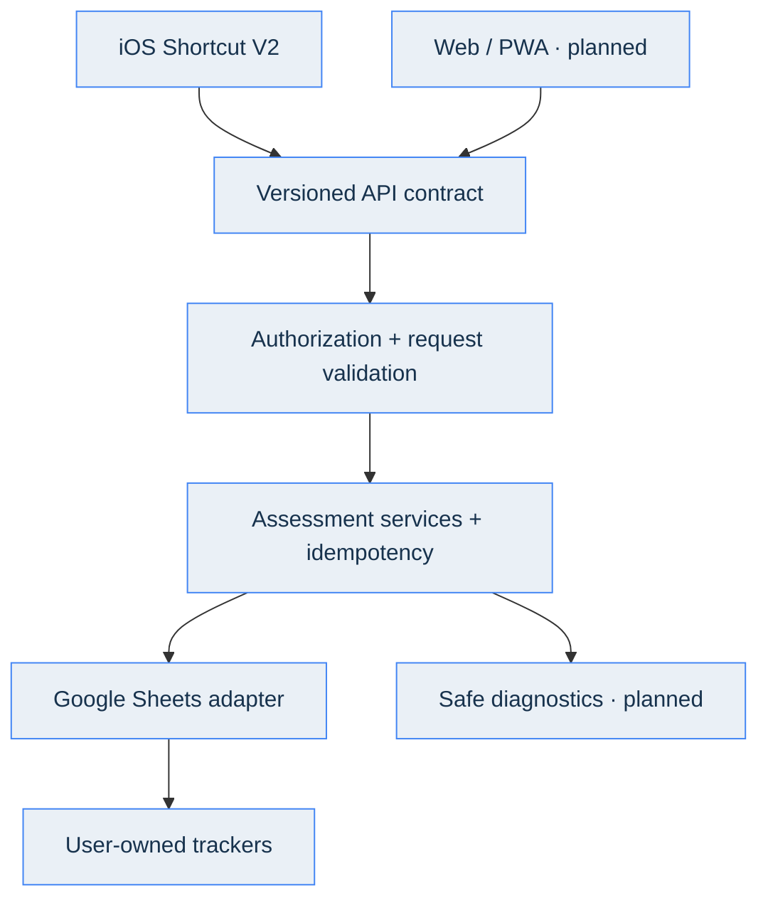
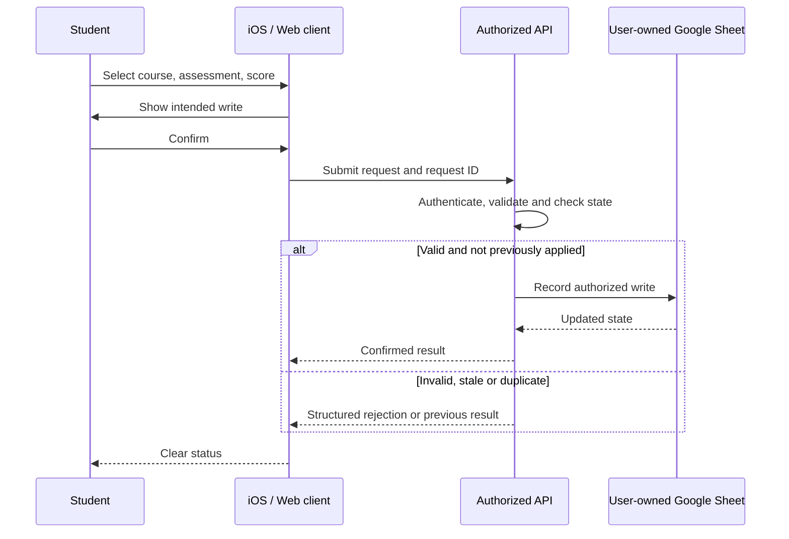

# 🏗️ Calify — Architecture

> **Evidence labels:** **Verified V1** means established integration or reviewed historical source. **Production inspection pending** means behavior has not been confirmed in the active modular codebase. **V2 proposal** describes a target, not a shipped feature.

## System Overview — Calify V1

**Diagram type:** High-Level System Architecture / Component Diagram. It maps **Mobile Client → Web API → Data Layer**. A Web App backend exists in V1, but a separate web UI does not.

## V1 — Existing System

**Diagram type:** Data Flow / Component Dependency Diagram. Arrows identify how data enters the tracker and how Grade Entry and Settings contribute to Control calculations and Dashboard output.

Existing tracker templates and their schema have been reviewed at the metadata level. Public documentation intentionally omits personal course inventories, spreadsheet identifiers, operational configuration and private audit evidence.

### Academic Tracker Contract

<table align="center">
<thead><tr><th align="center">Position</th><th align="center">Sheet</th><th align="center">Responsibility</th></tr></thead>
<tbody>
<tr><td align="center">1</td><td align="center"><code>Dashboard</code></td><td align="center">Display current status and grade projections</td></tr>
<tr><td align="center">2</td><td align="center"><code>Grade Entry</code></td><td align="center">Preserve assessment records and actual scores</td></tr>
<tr><td align="center">3</td><td align="center"><code>Control</code></td><td align="center">Compute results using verified course rules</td></tr>
<tr><td align="center">4</td><td align="center"><code>Settings</code></td><td align="center">Hold weights, configurations and grading parameters</td></tr>
</tbody>
</table>

The ledger comprises fourteen columns (A–N). The academic model distinguishes pending scores from legitimate zeros, actual earned results from projections, and scoring activities from completion-only activities. Some course headers and evaluation rules differ; adapters must not assume identical schemas merely from visual similarities.

## Legacy API — Historical Source Review

A historical single-file Apps Script backup includes:
- `doGet()` metadata response and `doPost(e)` action dispatch.
- `listCourses`, `listPending`, `recordScore`, and `markCompleted`.
- Token checking through Script Properties and script locking for writes.
- Spreadsheet lookup, grade updates, and Dashboard response summary.

The historical source presents risks around stale-score overwrites, string-built assessment IDs, blank-to-zero coercion, and partial writes. **These are not automatically verified defects in Production 1.1.**

The active Apps Script Production project contains multiple `.gs` modules; complete content-level audit and deployment comparison remain pending.

## V2 — Proposed Public Architecture

**Diagram type:** Proposed Logical Component Diagram. The V2 flow above is an architectural proposal, not an already deployed web client or API contract.

### Public Distribution Model

**First target:** a self-hosted edition where students own their Google Sheet(s), deployment, and configuration. The maintainer's production API and personal trackers must never become shared public infrastructure.

**Later possibility:** hosted multi-user service with separate identity, authorization, storage isolation and operational controls. This is a separate architectural decision, not a dependency of the initial public edition.

## Security Boundaries

**Diagram type:** **UML Sequence Diagram**, written with Mermaid `sequenceDiagram`. Time progresses top-to-bottom, showing messages between participants and alternative responses.

The sequence diagram is the **target behavior**, not a claim that all of these controls already exist.

## Engineering Constraints

- V1 is protected during recovery; no production deployments or live grade edits.
- The release source of truth should become reviewed Git history after safe recovery.
- Use staging and synthetic grade data for contract/regression testing.
- Build public onboarding before offering a distributable Shortcut.
- Prefer small verified improvements over an untested backend replacement.

See [Roadmap](ROADMAP.md) and [iOS Shortcut V2 Design](design/IOS_SHORTCUT_V2.md).
