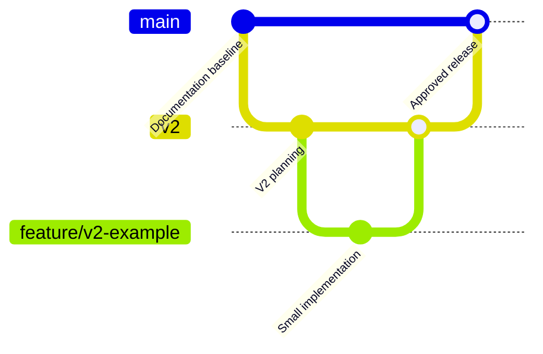

# 🌿 Calify — Git Branching Strategy

**Status:** Adopted project workflow. No Git branch alone represents a production deployment.

## Branch Model



The Mermaid diagram is illustrative; it is **not** an exact record of GitHub history or existing releases.

| Branch | Purpose | Merge Rule |
|:---:|:---:|:---:|
| `main` | Public stable project state and approved releases | Only reviewed changes and accepted releases |
| `v2` | Calify V2 integration branch | Reviewed PRs from feature and fix branches |
| `feature/v2-*` | One scoped V2 feature | PR to `v2` after tests |
| `fix/v2-*` | V2 defect correction | PR to `v2` after regression tests |

No dedicated `v1` branch is necessary for the current published documentation baseline. The personal V1 production Apps Script source is **not** represented as source code in this public repository yet.

## Workflow

1. Create a scoped branch from `v2`.
2. Implement one change with English code comments and safe example data.
3. Run static checks, tests, and privacy review.
4. Open a Pull Request targeting `v2`.
5. Review the diff and update docs/changelog.
6. Merge after checks pass.
7. Promote a release to `main` only after isolated staging tests and explicit approval.

## Commit Style

Use Conventional Commits:

```text
docs(calify): clarify architecture diagrams
feat(api): validate score submissions
fix(shortcut): handle missing assessments
test(backend): cover duplicate score writes
chore(ci): add staging checks
```

A project initialization commit traditionally uses `chore: initial commit` or `Initial commit`; existing history is kept intact rather than rewritten merely for cosmetic naming.

## Releases

Version labels and tags follow a deliberate release policy. A tag must point to tested, publishable source—not to unverified personal production code.
