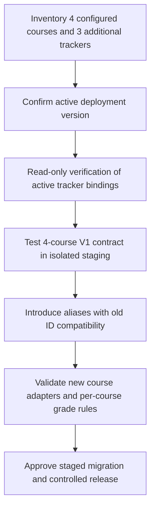

# Calify — Course Registry & Compatibility Plan

**Scope:** Phase 00 read-only registry reconciliation, with eventual changes assigned to hardening and public configuration phases.  
**Evidence:** Recovered Production v1.1.0 `config.gs`; owner-confirmed course set and operational feedback; previously audited live tracker structure.  
**Status:** No runtime registry change, Script Property mutation or Sheet edit performed.

## Course Registry: Current API vs. Proposed Display

<table align="center"><thead><tr><th align="center">Current API Key</th><th align="center">Current Course</th><th align="center">Proposed Display / Alias</th><th align="center">Status</th></tr></thead><tbody>
<tr><td align="center"><code>MC</code></td><td align="center">Computational Mathematics</td><td align="center"><code>CM</code> as a future friendly alias</td><td align="center">Active; user-confirmed</td></tr>
<tr><td align="center"><code>PH2</code></td><td align="center">Physics II</td><td align="center">Keep <code>PH2</code></td><td align="center">Active; user-confirmed</td></tr>
<tr><td align="center"><code>AP</code></td><td align="center">Applied Statistics I</td><td align="center">Confirm course abbreviation before selecting a new alias</td><td align="center">Active; user-confirmed</td></tr>
<tr><td align="center"><code>HCI</code></td><td align="center">HCI for UX Design</td><td align="center">Keep <code>HCI</code></td><td align="center">Active; spreadsheet binding requires review</td></tr>
<tr><td align="center">Not configured</td><td align="center">WeTALK English 2</td><td align="center">To be decided</td><td align="center">Candidate for later inclusion</td></tr>
<tr><td align="center">Not configured</td><td align="center">Architecture of Computers</td><td align="center">To be decided</td><td align="center">Candidate for later inclusion</td></tr>
<tr><td align="center">Not configured</td><td align="center">Database</td><td align="center">To be decided</td><td align="center">Candidate for later inclusion</td></tr>
</tbody></table>

## Why Rename and Expansion Must Wait

**Source-level evidence:** the live source registry uses `MC`, `PH2`, `AP` and `HCI` as keys and associates each with a Script Property key for an authorized spreadsheet. Renaming those keys without a compatibility layer may break the original Shortcut and old requests.

**Deployment-level evidence:** still unavailable. We do not yet know whether the deployed version equals the recovered source export, and the actual Script Property values are intentionally excluded from public inspection.

**User-facing design:** use a stable internal `courseId` and a separate `displayCode` / display name. A `CM` alias may resolve to existing `MC` only after the original client contract is checked. Do not silently migrate the underlying identifier.

## Proposed Migration Sequence

**Diagram type:** Engineering Migration Flowchart. The diagram depicts prerequisites, not deployed functionality.

## Immediate Rules

- **Pending scores:** a provisional score may be replaced if the activity's actual status is still `Pending`; the owner confirms this workflow is intentional.
- **Completed scores:** ordinary `recordScore` calls must not silently replace completed results. Explicit correction must use a controlled, separately authorized workflow.
- **Zero is valid:** numeric `0` is a real grade, while an empty value is not.
- **Extra trackers:** do not assume special score scales or academic weightings match existing courses. WeTALK and other trackers need dedicated contract checks.
- **HCI:** verify that its configured spreadsheet binding points to the correct, currently approved tracker **without exposing the ID publicly**.
- **Production:** no changes to credentials, web-app deployment, approved spreadsheets or existing iOS Shortcut during this phase.

## Delivery Assignment

- **Phase 00:** record registry and compatibility requirements; verify bindings read-only.
- **Phase 02:** address server-side validation, state transitions and backward-compatible aliases using staging and regression tests.
- **Phase 04:** make configuration reusable for additional self-hosted student courses.
- **Phase 05:** update the new iOS client to display friendly course names without breaking current V1.

**Study topics:** API compatibility, identifiers vs. display names, migration strategy, state machines, regression testing.

[Recovery Status](RECOVERY_STATUS.md) · [Roadmap](ROADMAP.md) · [Architecture](ARCHITECTURE.md)
