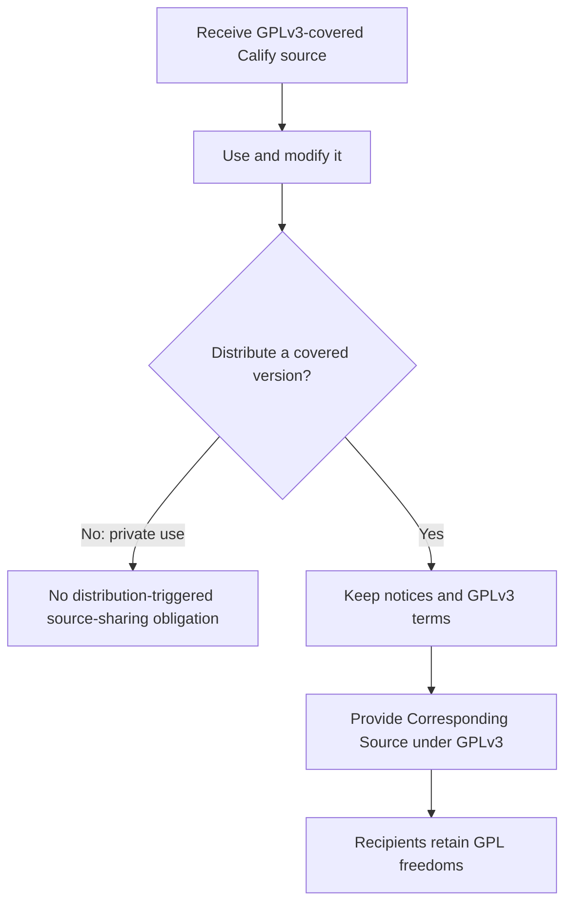

# ⚖️ Calify — GNU GPLv3 Licensing Guide

**Selected license:** GNU General Public License version 3.0 **only**  
**SPDX identifier:** `GPL-3.0-only`  
**Official text:** [`LICENSE`](../LICENSE) at the repository root  
**Upstream:** [GNU GPLv3](https://www.gnu.org/licenses/gpl-3.0.html)  
**Copyright notice:** Copyright © 2026 Yeremy Acuña

> This document explains the chosen license. It is informational, not a replacement for the full legal terms in `LICENSE`, and does not constitute legal advice.

## Decision

Calify's publicly released original repository material is offered under **GNU GPLv3 (version 3 only)** unless a particular file explicitly states otherwise. This is a strong **copyleft** license, not a proprietary or no-redistribution license. Third parties **may fork, copy, modify, redistribute, and sell covered software**, provided they comply with GPLv3.

A license does not automatically make unpublished personal software, APIs, private Shortcuts, secrets, or student grade data public. They remain excluded from the published repository and are not made available through this release.

## How Copyleft Works



**Key point:** GPLv3 preserves user freedoms when covered copies or modifications are distributed. Private modifications, without conveyance, generally do not trigger an obligation to publish source. Running a service purely over a network is not itself `conveying` under GPLv3; AGPLv3 is a different license with additional network-use provisions.

## Rights and Obligations

<div align="center">
<table align="center">
<thead><tr><th align="center">Situation</th><th align="center">GPLv3 Result</th></tr></thead>
<tbody>
<tr><td align="center">Use Calify privately</td><td align="center">Allowed under GPLv3</td></tr>
<tr><td align="center">Study and modify released code</td><td align="center">Allowed under GPLv3</td></tr>
<tr><td align="center">Create a fork or derivative</td><td align="center">Allowed, including commercial projects</td></tr>
<tr><td align="center">Distribute a modified covered program</td><td align="center">GPLv3 terms, prominent change notices, copyright notices, and source obligations apply</td></tr>
<tr><td align="center">Keep a personal modification private</td><td align="center">No general requirement to publish it merely because it was modified</td></tr>
<tr><td align="center">Charge money for a copy</td><td align="center">Allowed; license obligations still apply</td></tr>
<tr><td align="center">Remove recipients' GPL freedoms</td><td align="center">Not allowed for covered distribution</td></tr>
</tbody>
</table>
</div>

## Distribution Checklist

When Calify source code is ready for a reviewed release:

- Keep the full `LICENSE` text with distributions.
- Include appropriate copyright and licensing notices in source files.
- Identify meaningful modifications and their relevant dates when distributing modified source versions.
- Provide the **Corresponding Source** required by GPLv3 when conveying covered executable/object-code versions.
- Do not add restrictions that revoke recipients' rights granted by GPLv3.
- Audit third-party dependencies and asset licensing before publishing.
- Keep personal tokens, user spreadsheets, real academic records, private deployment URLs, and raw signed original Shortcuts out of release artifacts.

### Recommended Header for Future Calify Source Files

The following example intentionally chooses version **3 only**, not **3 or later**.

```js
// SPDX-License-Identifier: GPL-3.0-only
// Copyright (C) 2026 Yeremy Acuña
// This file is part of Calify.
//
// Calify is free software: you can redistribute it and/or modify
// it under the terms of the GNU General Public License as
// published by the Free Software Foundation, version 3.
//
// Calify is distributed in the hope that it will be useful,
// but WITHOUT ANY WARRANTY; without even the implied warranty
// of MERCHANTABILITY or FITNESS FOR A PARTICULAR PURPOSE.
// See the GNU General Public License for more details.
```

The final notices must be applied to actual released source files after reviewing ownership and third-party code. Do not simply assign copyright in code authored by someone else.

## Warranty and Liability

GPLv3 contains **NO WARRANTY** and **LIMITATION OF LIABILITY** sections. These aim to limit warranty and liability exposure to the extent permitted by applicable law. They are **not** a guarantee of immunity against all legal claims or responsibility for unsafe handling of other people's data.

## Branding and Third-Party Materials

The GPL does not automatically grant rights to the `Calify` name or trademarks. Future logos, icons, sample data, and third-party assets must have clear ownership/licensing statements when introduced. The original private Shortcut and proprietary service configuration are not supplied by this public repository.

## Version Choice

This project selects **GPL-3.0-only**. Do not add `or any later version` to Calify code headers without a separate decision from the copyright holder.

## References

- [Full GNU GPLv3 license](../LICENSE)
- [GNU GPLv3 original license page](https://www.gnu.org/licenses/gpl-3.0.html)
- [GNU GPL FAQ](https://www.gnu.org/licenses/gpl-faq.html)
- [GNU guidance on applying the license](https://www.gnu.org/licenses/gpl-howto.html)
