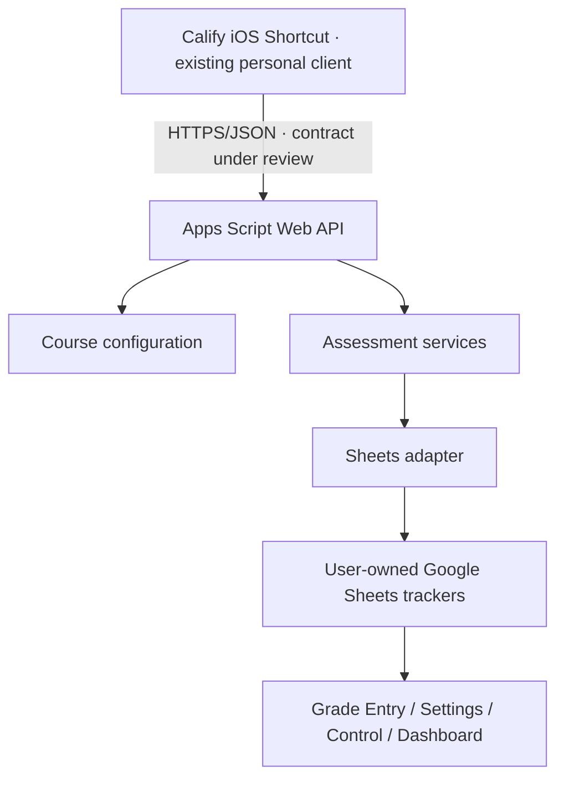

# Phase 00 — Recovery Status

**Status:** In progress · **Last review:** 2026-10-16  
**Scope:** Calify V1 source recovery and contract assessment (read-only)

## Recovery Milestones

<table align="center">
<thead><tr><th align="center">Workstream</th><th align="center">Status</th><th align="center">Public-safe outcome</th></tr></thead>
<tbody>
<tr><td align="center">Existing GitHub baseline</td><td align="center">Verified</td><td align="center">Documentation, GPLv3 and official brand assets published</td></tr>
<tr><td align="center">Apps Script Production export</td><td align="center">Recovered</td><td align="center">14 source modules plus Apps Script manifest preserved privately</td></tr>
<tr><td align="center">Historical Legacy export</td><td align="center">Recovered</td><td align="center">Single historical application script plus manifest preserved privately</td></tr>
<tr><td align="center">Backend read-only review</td><td align="center">In progress</td><td align="center">Current source components and action contracts mapped</td></tr>
<tr><td align="center">Isolated regression testing</td><td align="center">Partial</td><td align="center">Simulated tests completed without accessing production data</td></tr>
<tr><td align="center">Signed iOS Shortcut recovery</td><td align="center">Partial</td><td align="center">Envelope inspected; workflow actions not yet decoded</td></tr>
<tr><td align="center">Active deployment revision comparison</td><td align="center">Pending</td><td align="center">Source export is not proof of deployed version</td></tr>
<tr><td align="center">Staging environment</td><td align="center">Pending</td><td align="center">No clone/deployment created or modified</td></tr>
</tbody>
</table>

## Verified Architectural Summary

**Diagram type:** High-level Component/Data Flow Diagram for V1 source recovery. This is not a new product UI or evidence of a public installation.

## Recovery Integrity Rules

- Keep user credentials, private endpoints, signed personal Shortcuts, original source exports and confidential audit notes outside the public repository.
- Do not publish private vulnerability details before the relevant fix and security review.
- Do not run write-mode tests against real academic records.
- Preserve each course's original calculation rules and valid-zero vs pending-score semantics.
- Treat **exported source**, **deployed web-app revision**, and **live client behavior** as separate evidence levels.
- All production code and live grade modifications remain prohibited in this phase.

## Next Completion Gates

1. Decode the signed Shortcut and inventory ordered actions using a trusted compatible tool.
2. Compare actual Shortcut requests/responses with recovered backend source without exposing secrets.
3. Retrieve deployment revision metadata through authorized Google Apps Script tooling.
4. Complete the private risk register and prepare isolated staging acceptance tests.
5. Receive explicit approval before any refactor, API deployment or grade-write change.

**Related:** [Architecture](ARCHITECTURE.md) · [Roadmap](ROADMAP.md) · [Branching Strategy](BRANCHING_STRATEGY.md).
