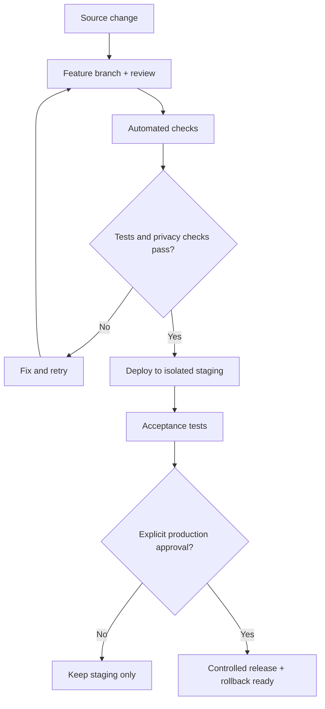

# 🗺️ Calify V2 — Product & Engineering Roadmap

> **Planning baseline:** this roadmap is versioned. A planned feature is not considered implemented until its acceptance tests pass.

## Product Goals

- Protect the working personal V1, original Shortcut and approved academic trackers.
- Recover Apps Script Production and audit the Shortcut **without publishing secrets**.
- Adopt reviewed Git history and a reproducible source-code development workflow.
- Ship a safe self-hosted student edition before considering hosted multi-user access.
- Improve iOS UX and later build a web/PWA client if the backend contract supports it.
- Learn JavaScript, testing, APIs and deployment through practical project work.

## Delivery Map

**Diagram type:** Roadmap Dependency Flowchart (`flowchart LR`): left-to-right arrows express planned phase ordering rather than completed deliverables.

## Phase 00 — Current Progress

**Source recovery checkpoint:** The Apps Script source project was exported to a **private** offline recovery bundle (14 `.gs` modules plus manifest), alongside the historic monolithic backup. An isolated in-memory regression suite identified items for the hardening backlog without accessing live grades. The signed Shortcut envelope was inspected, but its action payload still requires a compatible decoder. **This does not verify the currently deployed revision or authorize production changes.**

See [Recovery Status](RECOVERY_STATUS.md). Detailed technical audit material and the signed original Shortcut remain **private**.

## Milestones

<table align="center">
<thead><tr><th align="center">Phase</th><th align="center">Engineering Scope</th><th align="center">Learning Focus</th><th align="center">Status</th></tr></thead>
<tbody>
<tr><td align="center"><strong>00 — Recovery</strong></td><td align="center">Read-only inventory of current Shortcut and Production source</td><td align="center">JavaScript, Apps Script, HTTP/JSON</td><td align="center">In progress</td></tr>
<tr><td align="center"><strong>01 — Repository</strong></td><td align="center">Git layout, documentation, safe source imports, Git workflow</td><td align="center">Git, branch, PR, Conventional Commits, clasp</td><td align="center">In progress</td></tr>
<tr><td align="center"><strong>02 — Backend</strong></td><td align="center">Validation, state transitions, duplicates, identity, security, error handling</td><td align="center">Unit tests, idempotency, API design</td><td align="center">Planned</td></tr>
<tr><td align="center"><strong>03 — CI/CD</strong></td><td align="center">Staging, automated tests, release gates, rollback</td><td align="center">GitHub Actions, pipelines, deployments</td><td align="center">Planned</td></tr>
<tr><td align="center"><strong>04 — Public Setup</strong></td><td align="center">User-owned sheets and API setup without shared credentials</td><td align="center">Configuration, auth, least privilege</td><td align="center">Planned</td></tr>
<tr><td align="center"><strong>05 — iOS V2</strong></td><td align="center">New client flow, preview, confirmation, error recovery</td><td align="center">UX, Shortcuts, client/server boundaries</td><td align="center">Planned</td></tr>
<tr><td align="center"><strong>06 — Web/PWA</strong></td><td align="center">Responsive client consuming reviewed API</td><td align="center">Frontend, accessibility, web APIs</td><td align="center">Planned</td></tr>
<tr><td align="center"><strong>07 — Release</strong></td><td align="center">Documentation, integration tests, signed distributables</td><td align="center">QA, release notes, versioning</td><td align="center">Planned</td></tr>
<tr><td align="center"><strong>08 — Multi-user</strong></td><td align="center">Research hosted services, identity, isolation, storage</td><td align="center">Scalable system architecture</td><td align="center">Optional</td></tr>
</tbody>
</table>

## Quality Gates

<table align="center">
<thead><tr><th align="center">Gate</th><th align="center">Required Evidence</th></tr></thead>
<tbody>
<tr><td align="center">Privacy</td><td align="center">Secret scan and privacy review of every publishable artifact</td></tr>
<tr><td align="center">Integrity</td><td align="center">Pending vs score 0 tested; completed grade protection and duplicate requests</td></tr>
<tr><td align="center">Academic correctness</td><td align="center">Course-specific rules and weighted projections validated</td></tr>
<tr><td align="center">Compatibility</td><td align="center">Existing V1 remains available and unaffected</td></tr>
<tr><td align="center">Operations</td><td align="center">Isolated staging, controlled production deploys and rollback</td></tr>
<tr><td align="center">UX</td><td align="center">Real-device Shortcut test; public demo installation with synthetic data</td></tr>
<tr><td align="center">Documentation</td><td align="center">README, API contract, changelog and accurate release status</td></tr>
</tbody>
</table>

## Release Strategy

**Diagram type:** Release Process Flowchart (`flowchart TD`): decision nodes represent validation and approval gates before any deployment.

The production environment must never be overwritten simply because a GitHub commit exists. Reverse synchronization from Apps Script to GitHub may be evaluated during recovery, but requires a guarded diff/review process.

## Learning Contract (private track)

Each phase has a corresponding **private Learning Notes** track: a concise concept explanation, a self-contained example, exercises, Calify application, test cases, and a reflection linked to a reviewed commit. Personal study notes are not part of the public end-user repository.

## Branching Convention

- `main`: public documentation baseline and reviewed stable releases; no separate `v1` branch is required.
- `v2`: long-lived integration branch for Calify V2 development. Changes land through reviewed Pull Requests.
- `feature/v2-*` and `fix/v2-*`: short-lived working branches created from `v2`.
- Merge `v2` into `main` only after testing, privacy review, approval, and a versioned release.

See [Branching Strategy](BRANCHING_STRATEGY.md) for examples and release workflow.

## Architecture Decisions

Major technology or product changes will be recorded as **Architecture Decision Records (ADRs)** under `docs/decisions/`, with assumptions, trade-offs, decision, and rollback criteria.

## Working Rules

- All public repository text, source comments, diagram labels and documentation use English.
- Personal production data and credentials do not enter Git history, including private Git history.
- A blank score means pending; a numeric zero is valid.
- No silent modification of previously completed scores.
- No course-wide grade formula assumptions without course-specific evidence.
- "In progress" reflects documentation/recovery work, not a completed V2 backend.

**Last planning revision:** October 2026.
