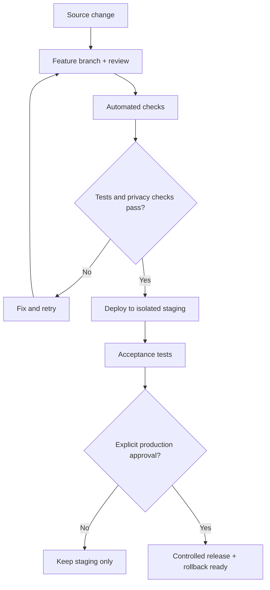

# 🗺️ Calify V2 — Product & Engineering Roadmap

> **Planning baseline:** this roadmap is versioned. A planned feature is not considered implemented until its acceptance tests pass.

## Product Goals

- Protect the working personal V1, original Shortcut and approved academic trackers.
- Recover Apps Script Production and audit the Shortcut **without publishing secrets**.
- Adopt reviewed Git history and a reproducible source-code development workflow.
- Ship a safe self-hosted student edition before considering hosted multi-user access.
- Improve iOS UX and later build a web/PWA client if the backend contract supports it.
- Learn JavaScript, testing, APIs and deployment through practical project work.

## Delivery Map

## Milestones

| Phase | Engineering Scope | Learning Focus | Status |
|:-----:|:-----------------:|:--------------:|:------:|
| **00 — Recovery** | Read-only inventory of current Shortcut and Production source | JavaScript, Apps Script, HTTP/JSON | In progress |
| **01 — Repository** | Git layout, documentation, safe source imports, Git workflow | Git, branch, PR, Conventional Commits, clasp | In progress |
| **02 — Backend** | Validation, state transitions, duplicates, identity, security, error handling | Unit tests, idempotency, API design | Planned |
| **03 — CI/CD** | Staging, automated tests, release gates, rollback | GitHub Actions, pipelines, deployments | Planned |
| **04 — Public Setup** | User-owned sheets and API setup without shared credentials | Configuration, auth, least privilege | Planned |
| **05 — iOS V2** | New client flow, preview, confirmation, error recovery | UX, Shortcuts, client/server boundaries | Planned |
| **06 — Web/PWA** | Responsive client consuming reviewed API | Frontend, accessibility, web APIs | Planned |
| **07 — Release** | Documentation, integration tests, signed distributables | QA, release notes, versioning | Planned |
| **08 — Multi-user** | Research hosted services, identity, isolation, storage | Scalable system architecture | Optional |

## Quality Gates

| Gate | Required Evidence |
|:----:|:-----------------:|
| Privacy | Secret scan and privacy review of every publishable artifact |
| Integrity | Pending vs score 0 tested; completed grade protection and duplicate requests |
| Academic correctness | Course-specific rules and weighted projections validated |
| Compatibility | Existing V1 remains available and unaffected |
| Operations | Isolated staging, controlled production deploys and rollback |
| UX | Real-device Shortcut test; public demo installation with synthetic data |
| Documentation | README, API contract, changelog and accurate release status |

## Release Strategy

The production environment must never be overwritten simply because a GitHub commit exists. Reverse synchronization from Apps Script to GitHub may be evaluated during recovery, but requires a guarded diff/review process.

## Learning Contract (private track)

Each phase has a corresponding **private Learning Notes** track: a concise concept explanation, a self-contained example, exercises, Calify application, test cases, and a reflection linked to a reviewed commit. Personal study notes are not part of the public end-user repository.

## Architecture Decisions

Major technology or product changes will be recorded as **Architecture Decision Records (ADRs)** under `docs/decisions/`, with assumptions, trade-offs, decision, and rollback criteria.

## Working Rules

- All public repository text, source comments, diagram labels and documentation use English.
- Personal production data and credentials do not enter Git history, including private Git history.
- A blank score means pending; a numeric zero is valid.
- No silent modification of previously completed scores.
- No course-wide grade formula assumptions without course-specific evidence.
- "In progress" reflects documentation/recovery work, not a completed V2 backend.

**Last planning revision:** October 2026.
