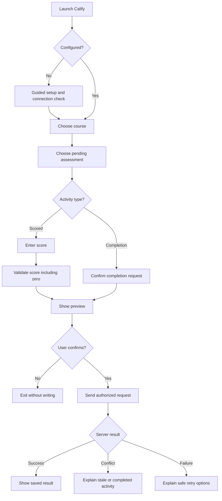

# 📱 Calify iOS Shortcut V2 — Design Proposal

**Document type:** UX and integration design, **not a V1 audit report**.  
**Status:** Proposed; must be validated against the decoded original Shortcut and active Production API.

## What This Document Is

This is a **future client experience specification**: what screens and operations Calify Shortcut V2 should support, how the user moves between them, and what safeguards the backend must provide.

It is not a list of verified current Shortcut actions. A separate, private audit will document V1's exact action-by-action behavior once the original signed archive can be decoded.

## User Journey

## Experience Requirements

| Feature | Intended Behavior | Verification |
|:-------:|:-----------------:|:------------:|
| First-run setup | Guide students through their own configuration | Planned |
| Dynamic course list | Read courses from the authorized API | Requires contract audit |
| Pending assessments | Display readable names, dates and scoring mode | Requires contract audit |
| Grade entry | Accept a valid numeric zero and reject missing input | Planned |
| Preview | Show the write before sending any mutation | Planned |
| Safe submit | Server checks authorization, state and duplicate requests | Planned |
| Failure feedback | Distinguish network failure, stale record, auth error | Planned |
| Accessibility | Clear labels, predictable navigation and cancellation | Planned |

## Privacy and Configuration

The distributable template must **never** include the maintainer's token, production API URL, private spreadsheet IDs, actual academic records, or identifying metadata. A self-hosted student's endpoint belongs to that student's own configuration. Secret removal must not break authentication; the mechanism must be redesigned where needed.

A signed `.shortcut` archive is not automatically secret-free. The distribution artifact must be decoded/scanned after construction and independently validated on an iPhone.

## API Contract Questions

Before implementation, verify against **active Production**:
1. Current action names, request/response fields, and error shapes.
2. Course IDs, activity IDs, and score/completion mode.
3. Whether write requests support idempotency and stale-state rejection.
4. How the endpoint authenticates students and handles failures.
5. Whether requests can operate safely on separate student-owned trackers.

## Test Cases

| Scenario | Acceptance Requirement |
|:--------:|:----------------------:|
| Score = 0 | Valid recording with clear confirmation |
| Score missing | No write |
| Above max / negative | Validation error |
| Completed activity | No silent overwrite |
| Duplicate request | No duplicate mutation |
| No pending activities | Clear empty state |
| Unauthorized endpoint | No write; actionable feedback |
| Timeout / offline | Clear uncertainty, safe recovery |
| User cancellation | No mutation |
| Demo installation | Successful first-time setup with fake data |

## Source & Release Controls

The active original Shortcut and its backup stay unchanged. No sanitized public artifact is approved until the complete action audit, sensitive-value replacement, backend security testing, import validation, and real-device regression are done.

**Related documents:** [Architecture](../ARCHITECTURE.md) · [Roadmap](../ROADMAP.md) · [Security](../SECURITY.md).
