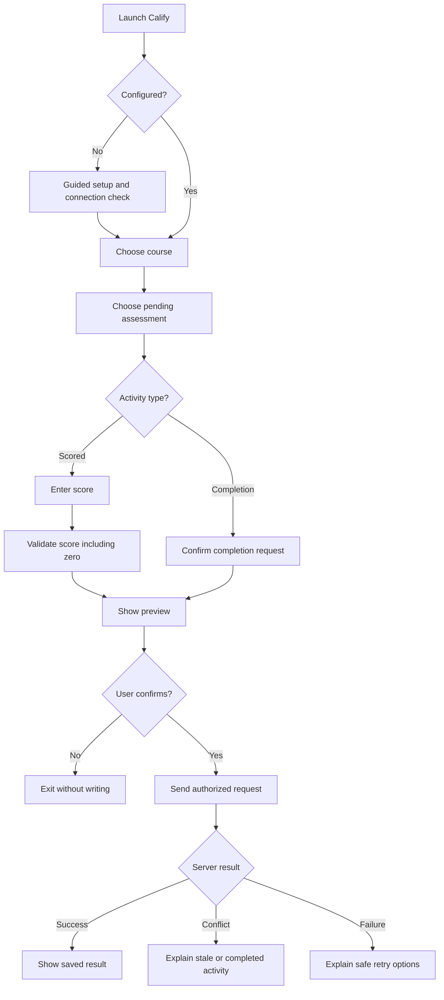

# 📱 Calify iOS Shortcut V2 — Design Proposal

**Document type:** UX and integration design, **not a V1 audit report**.  
**Status:** Proposed; must be validated against the decoded original Shortcut and active Production API.

## What This Document Is

This is a **future client experience specification**: what screens and operations Calify Shortcut V2 should support, how the user moves between them, and what safeguards the backend must provide.

It is not a list of verified current Shortcut actions. A separate, private audit will document V1's exact action-by-action behavior once the original signed archive can be decoded.

## User Flow Diagram

**Diagram type:** **User Flow Diagram (Process Flowchart)**, authored directly in Markdown using a Mermaid `flowchart TD` code block. It represents user actions and decisions, not a full UX User Journey Map with emotions, motivations, and pain points.

## Experience Requirements

<table align="center">
<thead><tr><th align="center">Feature</th><th align="center">Intended Behavior</th><th align="center">Verification</th></tr></thead>
<tbody>
<tr><td align="center">First-run setup</td><td align="center">Guide students through their own configuration</td><td align="center">Planned</td></tr>
<tr><td align="center">Dynamic course list</td><td align="center">Read courses from the authorized API</td><td align="center">Requires contract audit</td></tr>
<tr><td align="center">Pending assessments</td><td align="center">Display readable names, dates and scoring mode</td><td align="center">Requires contract audit</td></tr>
<tr><td align="center">Grade entry</td><td align="center">Accept a valid numeric zero and reject missing input</td><td align="center">Planned</td></tr>
<tr><td align="center">Preview</td><td align="center">Show the write before sending any mutation</td><td align="center">Planned</td></tr>
<tr><td align="center">Safe submit</td><td align="center">Server checks authorization, state and duplicate requests</td><td align="center">Planned</td></tr>
<tr><td align="center">Failure feedback</td><td align="center">Distinguish network failure, stale record, auth error</td><td align="center">Planned</td></tr>
<tr><td align="center">Accessibility</td><td align="center">Clear labels, predictable navigation and cancellation</td><td align="center">Planned</td></tr>
</tbody>
</table>

## Privacy and Configuration

The distributable template must **never** include the maintainer's token, production API URL, private spreadsheet IDs, actual academic records, or identifying metadata. A self-hosted student's endpoint belongs to that student's own configuration. Secret removal must not break authentication; the mechanism must be redesigned where needed.

A signed `.shortcut` archive is not automatically secret-free. The distribution artifact must be decoded/scanned after construction and independently validated on an iPhone.

## API Contract Questions

Before implementation, verify against **active Production**:
1. Current action names, request/response fields, and error shapes.
2. Course IDs, activity IDs, and score/completion mode.
3. Whether write requests support idempotency and stale-state rejection.
4. How the endpoint authenticates students and handles failures.
5. Whether requests can operate safely on separate student-owned trackers.

## Test Cases

<table align="center">
<thead><tr><th align="center">Scenario</th><th align="center">Acceptance Requirement</th></tr></thead>
<tbody>
<tr><td align="center">Score = 0</td><td align="center">Valid recording with clear confirmation</td></tr>
<tr><td align="center">Score missing</td><td align="center">No write</td></tr>
<tr><td align="center">Above max / negative</td><td align="center">Validation error</td></tr>
<tr><td align="center">Completed activity</td><td align="center">No silent overwrite</td></tr>
<tr><td align="center">Duplicate request</td><td align="center">No duplicate mutation</td></tr>
<tr><td align="center">No pending activities</td><td align="center">Clear empty state</td></tr>
<tr><td align="center">Unauthorized endpoint</td><td align="center">No write; actionable feedback</td></tr>
<tr><td align="center">Timeout / offline</td><td align="center">Clear uncertainty, safe recovery</td></tr>
<tr><td align="center">User cancellation</td><td align="center">No mutation</td></tr>
<tr><td align="center">Demo installation</td><td align="center">Successful first-time setup with fake data</td></tr>
</tbody>
</table>

## Source & Release Controls

The active original Shortcut and its backup stay unchanged. No sanitized public artifact is approved until the complete action audit, sensitive-value replacement, backend security testing, import validation, and real-device regression are done.

**Related documents:** [Architecture](../ARCHITECTURE.md) · [Roadmap](../ROADMAP.md) · [Security](../SECURITY.md).
